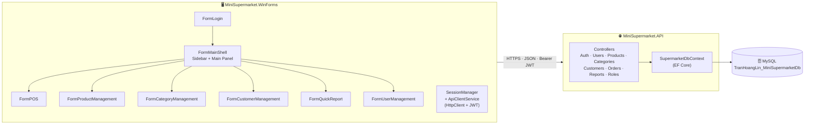
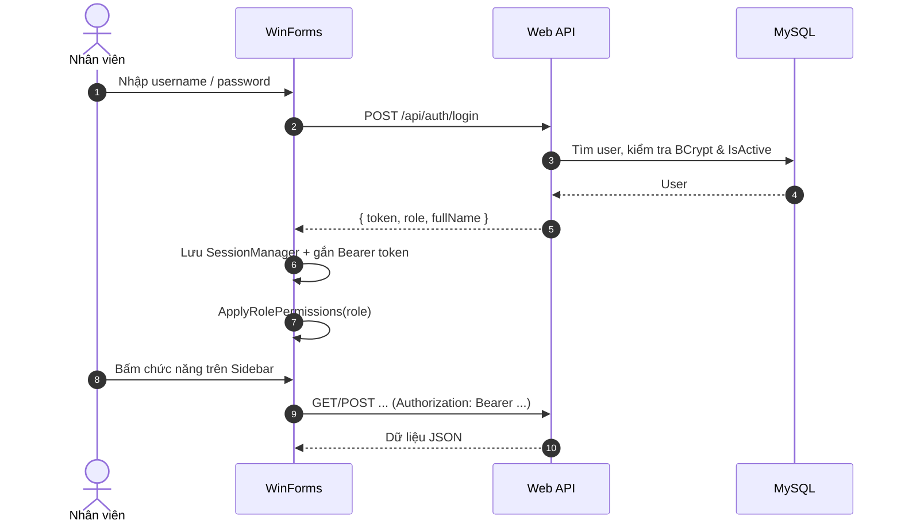
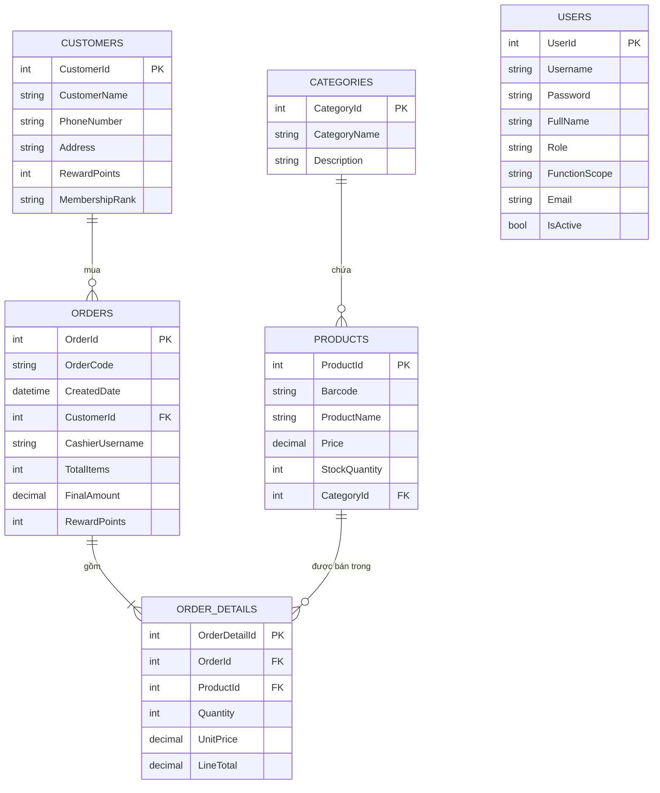
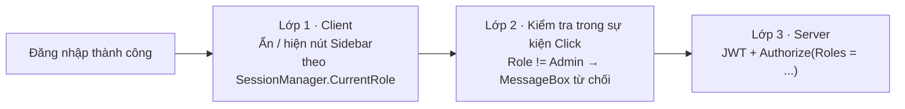

<div align="center">

# 🛒 MiniSupermarket POS

### Hệ thống Quản lý Bán lẻ & Tồn kho Siêu thị Mini

**Desktop WinForms** &nbsp;⇄&nbsp; **ASP.NET Core Web API** &nbsp;⇄&nbsp; **MySQL**

<br>


<p>
  <b>Single-Form Shell</b> • <b>Dynamic Child Forms</b> • <b>Role-Based Access Control</b> • <b>Barcode POS</b> • <b>Tích điểm khách hàng</b>
</p>

</div>

---

## 📑 Mục lục

1. [Giới thiệu](#-giới-thiệu)
2. [Tính năng nổi bật](#-tính-năng-nổi-bật)
3. [Kiến trúc hệ thống](#-kiến-trúc-hệ-thống)
4. [Cấu trúc Solution](#-cấu-trúc-solution)
5. [Công nghệ & thư viện](#-công-nghệ--thư-viện)
6. [Thiết kế cơ sở dữ liệu](#-thiết-kế-cơ-sở-dữ-liệu)
7. [Giao diện WinForms Shell](#-giao-diện-winforms-shell)
8. [Phân quyền RBAC](#-phân-quyền-rbac)
9. [Danh sách REST API](#-danh-sách-rest-api)
10. [Hướng dẫn cài đặt & chạy](#-hướng-dẫn-cài-đặt--chạy)
11. [Tài khoản kiểm thử](#-tài-khoản-kiểm-thử)
12. [Quy tắc nghiệp vụ](#-quy-tắc-nghiệp-vụ)
13. [Lưu ý bảo mật](#-lưu-ý-bảo-mật)
14. [Checklist nghiệm thu](#-checklist-nghiệm-thu)
15. [Tác giả](#-tác-giả)

---

## 📖 Giới thiệu

**MiniSupermarket POS** là ứng dụng quản lý bán lẻ cho siêu thị mini, gồm hai thành phần chạy độc lập:

| Thành phần | Vai trò |
| :--- | :--- |
| 🖥️ **`MiniSupermarket.WinForms`** | Ứng dụng desktop cho nhân viên: đăng nhập, bán hàng POS, quản lý kho, khách hàng, báo cáo |
| 🌐 **`MiniSupermarket.API`** | Web API xử lý nghiệp vụ, xác thực JWT, truy cập cơ sở dữ liệu MySQL |

Ứng dụng áp dụng kiến trúc **giao diện đơn khung (Single-Form Architecture)**: toàn bộ nghiệp vụ chạy trong một cửa sổ `FormMainShell` gồm thanh điều hướng bên trái và vùng làm việc trung tâm, các Form con được nhúng động vào vùng này thay vì mở nhiều cửa sổ rời rạc. Menu tự thích ứng theo **3 vai trò**: `Admin`, `Cashier` (Thu ngân), `Warehouse` (Thủ kho).

---

## ✨ Tính năng nổi bật

| | Tính năng | Mô tả |
| :-: | :--- | :--- |
| 🔐 | **Đăng nhập JWT** | Token hết hạn sau 2 giờ, mật khẩu băm **BCrypt**, hỗ trợ khóa/mở khóa tài khoản |
| 🧭 | **Shell điều hướng** | Sidebar + vùng làm việc, nhúng Form con bằng `TopLevel = false`, `Dock = Fill` |
| 🛡️ | **Phân quyền 2 lớp** | Ẩn nút ở giao diện (client) và chặn bằng `[Authorize(Roles)]` ở máy chủ |
| 🧾 | **POS bán hàng** | Quét mã vạch bằng phím `Enter`, giỏ hàng, tính tiền thừa, thanh toán |
| 📦 | **Quản lý sản phẩm & kho** | CRUD sản phẩm, tìm theo mã vạch, lọc theo nhóm hàng, tự động trừ tồn kho khi bán |
| 📁 | **Quản lý danh mục** | CRUD nhóm hàng, tìm kiếm theo tên |
| 👥 | **Khách hàng thân thiết** | Tra cứu theo SĐT, **tích điểm** và **tự nâng hạng** thẻ |
| 📊 | **Báo cáo doanh thu ngày** | Tổng hóa đơn, tổng doanh thu, mặt hàng bán chạy nhất |
| 🧑‍💼 | **Quản trị tài khoản** | Tạo tài khoản, đổi vai trò, khóa/mở khóa, đặt lại mật khẩu |
| 🔄 | **Tự động migrate** | API tự tạo/cập nhật database bằng EF Core Migrations khi khởi động |

---

## 🏗 Kiến trúc hệ thống



**Luồng đăng nhập & gọi API**



---

## 📂 Cấu trúc Solution

```text
MiniSuperMarket-Tran_Hoang_Lin/
├── 📄 MiniSuperMarket-Tran_Hoang_Lin.sln          # Solution gồm 2 project
├── 📄 README.md
├── 📄 .gitignore
├── 📄 .gitattributes
│
├── 🌐 MiniSupermarket.API/                        # ── ASP.NET Core Web API (net8.0)
│   ├── 📁 Controllers/
│   │   ├── AuthController.cs                      # POST  /api/auth/login  (phát hành JWT)
│   │   ├── UsersController.cs                     # CRUD tài khoản, đổi vai trò, khóa/mở khóa
│   │   ├── RolesController.cs                     # Danh sách vai trò (lưu tạm trên RAM)
│   │   ├── ProductsController.cs                  # CRUD sản phẩm, tra cứu theo barcode
│   │   ├── CategoriesController.cs                # CRUD nhóm hàng, tìm kiếm
│   │   ├── CustomersController.cs                 # CRUD khách hàng, tra cứu theo SĐT
│   │   ├── OrdersController.cs                    # POST  /api/orders/checkout
│   │   ├── ReportsController.cs                   # Báo cáo doanh thu theo ngày
│   │   └── WeatherForecastController.cs           # Mẫu mặc định của template
│   ├── 📁 Models/                                 # Entity (EF Core)
│   │   ├── Category.cs   Product.cs   Customer.cs
│   │   ├── Order.cs      OrderDetail.cs
│   │   └── User.cs       Role.cs
│   ├── 📁 Data/
│   │   └── SupermarketDbContext.cs                # DbContext + Data Seeding (15 bản ghi/bảng)
│   ├── 📁 Helpers/
│   │   └── PasswordHelper.cs                      # Băm & xác thực mật khẩu BCrypt
│   ├── 📁 Migrations/                             # EF Core Migrations (11 bản)
│   ├── 📁 Properties/
│   │   └── launchSettings.json                    # http://localhost:5150 · https://localhost:7167
│   ├── Program.cs                                 # Cấu hình DI, JWT, Swagger, auto-migrate
│   ├── appsettings.json                           # Connection string & JWT secret
│   └── MiniSupermarket.API.csproj
│
└── 🖥️ MiniSupermarket.WinForms/                   # ── Windows Forms (net8.0-windows)
    ├── 📁 Models/
    │   └── ReportDto.cs
    ├── 📁 Properties/
    │   └── Resources.resx / Resources.Designer.cs
    ├── Program.cs                                 # Điểm khởi chạy → FormLogin
    ├── SessionManager.cs                          # Phiên đăng nhập + ApiClientService (HttpClient + JWT)
    │
    ├── FormLogin.cs                               # 🔑 Đăng nhập
    ├── FormMainShell.cs                           # 🧭 Khung điều hướng chính + phân quyền
    │
    ├── FormPOS.cs                                 # 🧾 Bán hàng quét mã vạch
    ├── FormProductManagement.cs                   # 📦 Quản lý sản phẩm & tồn kho
    ├── FormCategoryManagement.cs                  # 📁 Quản lý danh mục nhóm hàng
    ├── FormCustomerManagement.cs                  # 👥 Quản lý khách hàng & tích điểm
    ├── FormQuickReport.cs                         # 📊 Báo cáo doanh thu nhanh
    ├── FormUserManagement.cs                      # 🛡️ Quản trị tài khoản
    ├── FormRoleManagement.cs                      # 🏷️ Quản lý vai trò
    │
    └── MiniSupermarket.WinForms.csproj
```

> Mỗi Form gồm bộ ba tệp: `*.cs` (logic), `*.Designer.cs` (giao diện do Visual Studio sinh), `*.resx` (tài nguyên).

---

## 🧰 Công nghệ & thư viện

| Lớp | Công nghệ | Phiên bản |
| :--- | :--- | :--- |
| Runtime | .NET | `8.0` |
| Desktop UI | Windows Forms | `net8.0-windows` |
| Web API | ASP.NET Core Web API | `8.0` |
| ORM | Entity Framework Core | `8.0.31` |
| Provider CSDL | Pomelo.EntityFrameworkCore.MySql | `8.0.2` |
| Xác thực | Microsoft.AspNetCore.Authentication.JwtBearer | `8.0.31` |
| Mã hóa mật khẩu | BCrypt.Net-Next | `4.2.0` |
| Tài liệu API | Swashbuckle.AspNetCore (Swagger) | `6.6.2` |
| JWT | System.IdentityModel.Tokens.Jwt | `8.23.0` |

---

## 🗄 Thiết kế cơ sở dữ liệu



| Bảng | Mô tả | Dữ liệu mẫu (seed) |
| :--- | :--- | :-: |
| `Categories` | Nhóm hàng | 15 |
| `Products` | Sản phẩm, mã vạch, giá, tồn kho | 15 |
| `Customers` | Khách hàng thân thiết | 15 |
| `Users` | Nhân viên / tài khoản hệ thống | 15 |
| `Orders` | Hóa đơn bán hàng | 15 |
| `OrderDetails` | Chi tiết từng dòng hóa đơn | 15 |

> `Users.Username` liên kết **logic** với `Orders.CashierUsername` (không khai báo khóa ngoại). Bảng vai trò hiện được lưu tạm trong bộ nhớ ở `RolesController`.

---

## 🖥 Giao diện WinForms Shell

Khung điều khiển trung tâm `FormMainShell` (độ phân giải chuẩn `1280 × 720`):

```text
┌─────────────────────────────────────────────────────────────────────────────┐
│                              FormMainShell                                  │
├────────────────────┬────────────────────────────────────────────────────────┤
│  panelSidebar      │  panelTopHeader  (Tiêu đề màn hình & Thông tin User)   │
│  (Width = 230)     ├────────────────────────────────────────────────────────┤
│                    │                                                        │
│  🛒 MiniMart POS   │  panelMainContent  (Dock = Fill)                       │
│  ─────────────     │                                                        │
│  🛒 Bán hàng (POS) │   ┌────────────────────────────────────────────────┐   │
│  📁 Danh mục       │   │   VÙNG NHÚNG ĐỘNG CÁC FORM NGHIỆP VỤ CON       │   │
│  📦 Sản phẩm       │   │                                                │   │
│  👥 Khách hàng     │   │   • FormPOS               • FormCustomer…      │   │
│  📊 Báo cáo        │   │   • FormCategory…         • FormQuickReport    │   │
│  🛡 Tài khoản      │   │   • FormProduct…          • FormUserManagement │   │
│  ─────────────     │   └────────────────────────────────────────────────┘   │
│  🚪 Đăng xuất      │                                                        │
└────────────────────┴────────────────────────────────────────────────────────┘
```

**Cơ chế nhúng Form con (`OpenChildForm`)**

```csharp
childForm.TopLevel        = false;                     // bỏ cửa sổ độc lập
childForm.FormBorderStyle = FormBorderStyle.None;      // bỏ viền & thanh tiêu đề
childForm.Dock            = DockStyle.Fill;            // tràn kín panelMainContent
panelMainContent.Controls.Clear();
panelMainContent.Controls.Add(childForm);
childForm.Show();
```

Khi bấm một nút trên Sidebar: Form cũ được đóng → nút được tô sáng (`HighlightActiveButton`) → Form mới được nhúng → tiêu đề `lblTitle` đồng bộ theo màn hình.

---

## 🔐 Phân quyền RBAC

### Ma trận quyền truy cập giao diện

| Chức năng (nút Sidebar) | 👑 Admin | 🧾 Cashier | 📦 Warehouse |
| :--- | :-: | :-: | :-: |
| 🛒 Bán hàng POS | ✅ | ✅ | ❌ |
| 📁 Quản lý Danh mục | ✅ | ❌ | ✅ |
| 📦 Quản lý Sản phẩm | ✅ | ✅ ¹ | ✅ |
| 👥 Quản lý Khách hàng | ✅ | ✅ | ❌ |
| 📊 Báo cáo Doanh thu | ✅ | ❌ | ❌ |
| 🛡 Quản trị Tài khoản | ✅ | ❌ | ❌ |

> ¹ Trong mã nguồn hiện tại, `Cashier` được hiển thị nút **Sản phẩm** để tra cứu giá/tồn kho. Nếu muốn khóa hoàn toàn theo đề bài gốc, đặt `btnProduct.Visible = false` trong nhánh `"CASHIER"` của `ApplyRolePermissions`.

### Màn hình mặc định sau đăng nhập

| Vai trò | Màn hình mở đầu |
| :--- | :--- |
| 👑 Admin | Quản lý Danh mục |
| 🧾 Cashier | Quản lý Khách hàng / POS |
| 📦 Warehouse | Quản lý Danh mục / Sản phẩm |

### Bảo vệ 2 lớp



---

## 🌐 Danh sách REST API

Base URL: `https://localhost:7167/api` &nbsp;|&nbsp; Swagger UI: `https://localhost:7167/swagger`

> 🔒 = yêu cầu header `Authorization: Bearer <token>`

### 🔑 Auth & Users

| Method | Endpoint | Mô tả | Auth |
| :-: | :--- | :--- | :-: |
| `POST` | `/auth/login` | Đăng nhập, nhận JWT + role + họ tên | — |
| `GET` | `/users` | Danh sách tài khoản | 🔒 |
| `GET` | `/users/{id}` | Chi tiết tài khoản | 🔒 |
| `POST` | `/users` | Tạo tài khoản mới | 🔒 |
| `PUT` | `/users/{id}` | Cập nhật tài khoản | 🔒 |
| `PUT` | `/users/{id}/role` | Đổi vai trò | 🔒 |
| `PUT` | `/users/{id}/status` | Khóa / mở khóa | 🔒 |
| `DELETE` | `/users/{id}` | Xóa tài khoản | 🔒 |
| `GET` | `/roles` · `/roles/{id}` | Danh sách / chi tiết vai trò | — |
| `POST` `PUT` `DELETE` | `/roles` · `/roles/{id}` | Thêm / sửa / xóa vai trò (RAM) | — |

### 📦 Products & Categories

| Method | Endpoint | Mô tả | Auth |
| :-: | :--- | :--- | :-: |
| `GET` | `/products` | Danh sách sản phẩm | 🔒 |
| `GET` | `/products/{id}` | Chi tiết sản phẩm | 🔒 |
| `GET` | `/products/barcode/{barcode}` | Tra cứu theo mã vạch (dùng cho POS) | 🔒 |
| `POST` `PUT` `DELETE` | `/products` · `/products/{id}` | Thêm / sửa / xóa sản phẩm | 🔒 |
| `GET` | `/categories` · `/categories/{id}` | Danh sách / chi tiết nhóm hàng | 🔒 |
| `GET` | `/categories/search` | Tìm nhóm hàng | 🔒 |
| `POST` `PUT` `DELETE` | `/categories` · `/categories/{id}` | Thêm / sửa / xóa nhóm hàng | 🔒 |
| `GET` | `/categories/admin-dashboard` | Điểm kiểm thử quyền | 🔒 `Admin` |
| `GET` | `/categories/staff-pos` | Điểm kiểm thử quyền | 🔒 `Admin, Cashier` |

### 👥 Customers, Orders & Reports

| Method | Endpoint | Mô tả | Auth |
| :-: | :--- | :--- | :-: |
| `GET` | `/customers` · `/customers/{id}` | Danh sách / chi tiết khách hàng | 🔒 |
| `GET` | `/customers/phone/{phone}` | Tra cứu theo số điện thoại | 🔒 |
| `GET` | `/customers/search` | Tìm khách hàng | 🔒 |
| `POST` `PUT` `DELETE` | `/customers` · `/customers/{id}` | Thêm / sửa / xóa khách hàng | 🔒 |
| `POST` | `/orders/checkout` | Thanh toán: trừ kho, tích điểm, lập hóa đơn | 🔒 |
| `GET` | `/reports/daily?date=yyyy-MM-dd` | Tổng hóa đơn, doanh thu, hàng bán chạy | 🔒 |
| `GET` | `/reports/orders` | Danh sách hóa đơn | 🔒 |

**Ví dụ — thanh toán**

```http
POST /api/orders/checkout
Authorization: Bearer eyJhbGciOi...
Content-Type: application/json

{
  "cashierUsername": "cashier01",
  "customerPhone": "0901234567",
  "items": [
    { "productId": 1, "quantity": 2, "unitPrice": 15000 },
    { "productId": 5, "quantity": 1, "unitPrice": 10000 }
  ]
}
```

---

## 🚀 Hướng dẫn cài đặt & chạy

### Yêu cầu

- 🪟 **Windows 10/11** (WinForms chỉ chạy trên Windows)
- 🧩 **Visual Studio 2022** (workload *.NET desktop development* và *ASP.NET and web development*) hoặc **.NET 8 SDK**
- 🗄️ **MySQL / MariaDB** chạy ở cổng `3306` (ví dụ **XAMPP**)

### Các bước

**1️⃣ Clone dự án**

```bash
git clone https://github.com/<your-username>/MiniSuperMarket.git
cd MiniSuperMarket
```

**2️⃣ Cấu hình kết nối cơ sở dữ liệu** tại `MiniSupermarket.API/appsettings.json`

```json
{
  "ConnectionStrings": {
    "DefaultConnection": "Server=127.0.0.1;Port=3306;Database=TranHoangLin_MiniSupermarketDb;User=root;Password=;SslMode=None;"
  },
  "JwtSettings": {
    "Secret": "<chuỗi-bí-mật-dài-tối-thiểu-32-ký-tự>"
  }
}
```

**3️⃣ Khởi động MySQL** (bật module *MySQL* trong XAMPP Control Panel).

**4️⃣ Chạy Web API** — database và dữ liệu mẫu được **tự động tạo** nhờ `Database.Migrate()`

```bash
cd MiniSupermarket.API
dotnet run --launch-profile https
```

Mở Swagger kiểm tra: <https://localhost:7167/swagger>

**5️⃣ Chạy ứng dụng WinForms** (mở terminal thứ hai)

```bash
cd MiniSupermarket.WinForms
dotnet run
```

> 💡 **Visual Studio:** chuột phải Solution → *Configure Startup Projects* → chọn **Multiple startup projects** → đặt cả `MiniSupermarket.API` và `MiniSupermarket.WinForms` là *Start*, rồi nhấn `F5`.

> ⚠️ Địa chỉ API được gán cố định trong `SessionManager.cs` và `FormRoleManagement.cs` là `https://localhost:7167/api/`. Nếu đổi cổng, hãy sửa ở cả hai nơi.

### Tạo lại database từ đầu (tùy chọn)

```bash
cd MiniSupermarket.API
dotnet ef database drop
dotnet ef database update
```

---

## 👥 Tài khoản kiểm thử

Mật khẩu chung của tất cả tài khoản: **`123456`**

| STT | Username | Họ và tên | Vai trò | Phạm vi chức năng |
| :-: | :--- | :--- | :-: | :--- |
| 1 | `admin01` | Nguyễn Quản Trị | 👑 **Admin** | Toàn quyền hệ thống |
| 2 | `admin02` | Trần Giám Đốc | 👑 **Admin** | Toàn quyền hệ thống |
| 3 | `cashier01` | Lê Thu Ngân | 🧾 **Cashier** | POS, Khách hàng thành viên |
| 4 | `cashier02` | Phạm Bán Hàng | 🧾 **Cashier** | POS, Khách hàng thành viên |
| 5 | `cashier03` | Hoàng Thu Ngân | 🧾 **Cashier** | POS, Khách hàng thành viên |
| 6 | `cashier04` | Vũ Thị Quầy | 🧾 **Cashier** | POS, Khách hàng thành viên |
| 7 | `cashier05` | Đỗ Bán Lẻ | 🧾 **Cashier** | POS, Khách hàng thành viên |
| 8 | `ware01` | Ngô Quản Kho | 📦 **Warehouse** | Sản phẩm, Nhóm hàng, Nhập xuất kho |
| 9 | `ware02` | Bùi Kiểm Kê | 📦 **Warehouse** | Sản phẩm, Nhóm hàng, Nhập xuất kho |
| 10 | `ware03` | Dương Thủ Kho | 📦 **Warehouse** | Sản phẩm, Nhóm hàng, Nhập xuất kho |
| 11 | `ware04` | Lý Nhập Hàng | 📦 **Warehouse** | Sản phẩm, Nhóm hàng, Nhập xuất kho |
| 12 | `admin_backup` | Đặng Hỗ Trợ | 👑 **Admin** | Toàn quyền hệ thống |
| 13 | `cashier06` | Hồ Ca Chiều | 🧾 **Cashier** | POS, Khách hàng thành viên |
| 14 | `ware05` | Trương Vận Chuyển | 📦 **Warehouse** | Sản phẩm, Nhóm hàng, Nhập xuất kho |
| 15 | `supervisor` | Mai Giám Sát | 👑 **Admin** | Toàn quyền hệ thống |

> Mật khẩu mẫu được seed dạng văn bản thường, và **tự động nâng cấp sang BCrypt** ngay lần đăng nhập thành công đầu tiên của từng tài khoản.

---

## 📐 Quy tắc nghiệp vụ

### 🧾 Thanh toán (`/orders/checkout`)

1. Kiểm tra từng sản phẩm tồn tại và **đủ tồn kho**, nếu thiếu thì trả lỗi rõ ràng.
2. **Trừ tồn kho** và tính tổng tiền.
3. Nếu có SĐT khớp khách hàng → **tích điểm**; nếu không → ghi nhận **"Khách hàng vãng lai"** (không tích điểm).
4. Sinh mã hóa đơn dạng `HDyyyyMMdd-XXXXXX`, lưu `Orders` và `OrderDetails`.

### ⭐ Tích điểm & hạng thành viên

| Quy tắc | Giá trị |
| :--- | :--- |
| Quy đổi điểm | **10.000 ₫ = 1 điểm** |
| Hạng **Chuẩn** | mặc định (`< 50` điểm) |
| Hạng **Bạc** 🥈 | từ `50` điểm |
| Hạng **Vàng** 🥇 | từ `200` điểm |
| Hạng **Kim Cương** 💎 | từ `500` điểm |

### 📊 Báo cáo ngày

Trong khoảng `00:00:00 → 23:59:59` của ngày chọn: đếm số hóa đơn, cộng tổng doanh thu và tìm sản phẩm có **tổng số lượng bán cao nhất**.

---

## 🔒 Lưu ý bảo mật

Dự án phục vụ **học tập**. Trước khi triển khai thực tế, cần xử lý các điểm sau:

| Vấn đề | Hiện trạng | Khuyến nghị |
| :--- | :--- | :--- |
| 🔑 JWT Secret | Có giá trị mặc định trong `Program.cs` / `appsettings.json` | Dùng *User Secrets* hoặc biến môi trường, không commit lên GitHub |
| 🗝️ Mật khẩu DB | `root` không mật khẩu | Tạo user riêng, đặt mật khẩu mạnh |
| 🔓 SSL | WinForms bỏ qua kiểm tra chứng chỉ (`ServerCertificateCustomValidationCallback`) | Chỉ dùng khi chạy `localhost`, bỏ khi triển khai |
| 🏷️ `RolesController` | Chưa có `[Authorize]`, dữ liệu lưu RAM | Thêm `[Authorize(Roles = "Admin")]` và lưu vào CSDL |
| 🛡️ Phân quyền server | Một số controller mới chỉ yêu cầu đăng nhập | Bổ sung `[Authorize(Roles = ...)]` theo từng endpoint |

---

## ✅ Checklist nghiệm thu

- [x] **Single-Form Shell:** toàn bộ nghiệp vụ chạy trong `panelMainContent`, không mở cửa sổ rời rạc
- [x] **Đăng nhập JWT** và lưu phiên bằng `SessionManager`
- [x] `cashier01` ➜ Sidebar không có *Danh mục*, *Báo cáo*, *Tài khoản*
- [x] `ware01` ➜ Sidebar chỉ có *Danh mục* và *Sản phẩm*
- [x] `admin01` ➜ Hiển thị đủ **6** nút chức năng
- [x] Nút được chọn đổi màu nổi bật, tiêu đề `lblTitle` đồng bộ theo màn hình
- [x] **POS:** quét mã vạch → thêm giỏ → tính tiền thừa → thanh toán → trừ kho, tích điểm
- [x] **Báo cáo:** chỉ `Admin` truy cập được `FormQuickReport`
- [x] **Database:** tự migrate và seed dữ liệu mẫu khi chạy API lần đầu

---

## 👨‍🎓 Tác giả

<table>
  <tr>
    <td><b>Họ và tên</b></td>
    <td>Trần Hoàng Lin</td>
  </tr>
  <tr>
    <td><b>MSSV</b></td>
    <td>2124110134</td>
  </tr>
  <tr>
    <td><b>Trường</b></td>
    <td>Cao đẳng Công Thương TP.HCM</td>
  </tr>
  <tr>
    <td><b>Môn học</b></td>
    <td>Lập trình Ứng dụng .NET Core</td>
  </tr>
</table>

<div align="center">

<br>

⭐ Nếu thấy dự án hữu ích, hãy tặng một **Star** cho repository nhé! ⭐

*Made with ❤️ and C#*

</div>
